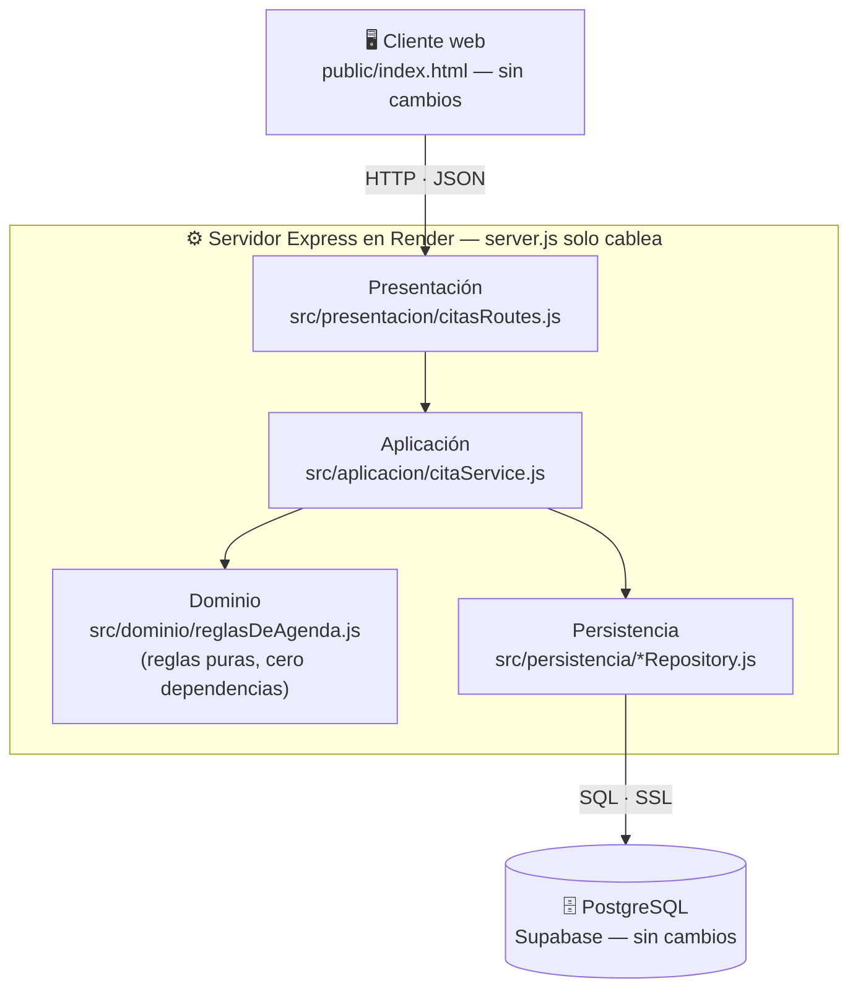
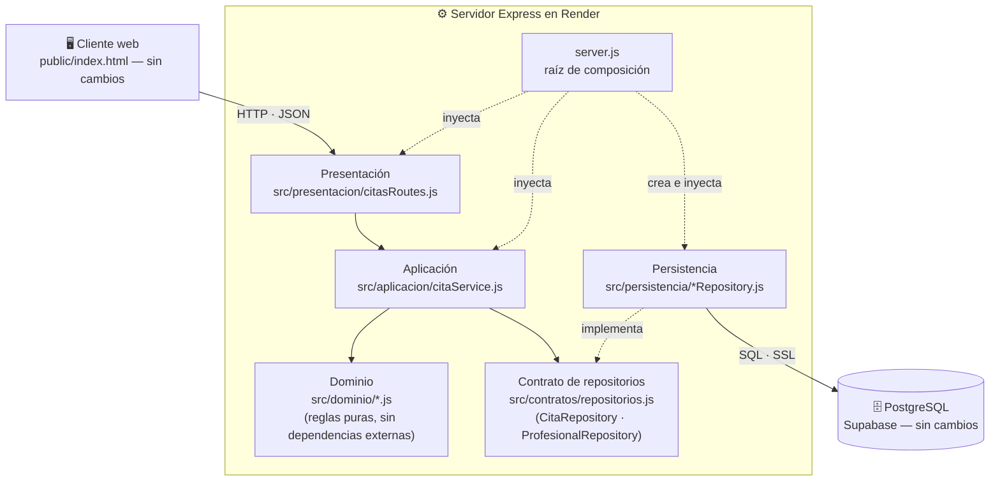
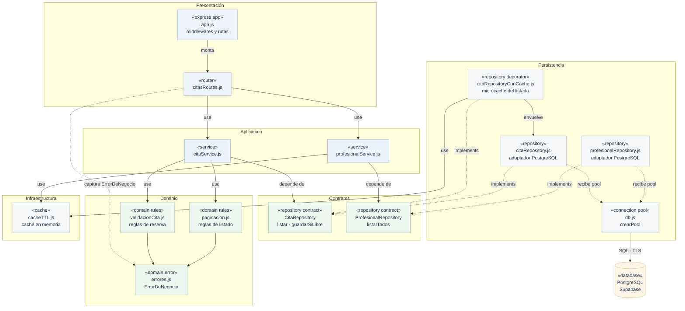
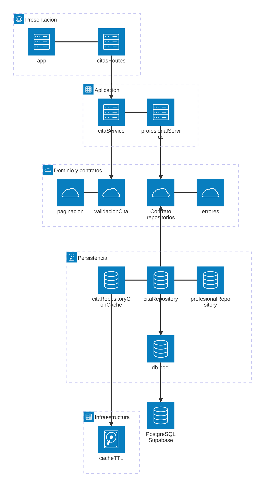

<div align="center">

# Reserva de Citas — Demo en Arquitectura de Capas

Sistema de referencia del curso **Arquitectura de Sistemas I** · Universidad Central · 2026-2

[](https://nodejs.org)
[](https://expressjs.com)
[](https://supabase.com)
[](https://render.com)

**[🌐 Demo en vivo](https://eng-demo-citas.onrender.com)** ·
**[📖 Guía de despliegue](https://eng-demo-citas.onrender.com/blog-semana-7.html)**

</div>

---

Aplicación mínima que demuestra dos vistas complementarias del mismo sistema: la vista **Cliente-Servidor** (quién habla con quién por la red — Semana 7) y la vista **en capas** (cómo se organiza el servidor por dentro — Semana 8). Esta versión es la refactorización en capas del `server.js` original: el comportamiento es idéntico, el cliente y la base de datos no cambiaron ni una línea.

> **La idea central del refactor:** se reorganizó el interior del servidor sin que nadie afuera lo note. Las capas organizan responsabilidades; no agregan servidores ni cambian el contrato HTTP.

## Mejoras en la rama `refactor/architecture`

Reestructuración interna sin cambios en la API ni en el cliente (mismos endpoints, códigos y respuestas):

- **Contrato de repositorios** (`contratos/repositorios.js`): la aplicación depende de interfaces (`CitaRepository`, `ProfesionalRepository`), verificadas al arrancar, y no de PostgreSQL.
- **Inyección de dependencias:** los repositorios, servicios y rutas son fábricas; `server.js` es la raíz de composición que los crea y conecta.
- **`app.js` separado del arranque:** Express se puede levantar sin abrir puerto ni base de datos (útil para pruebas).
- **Servicios por agregado:** `citaService` y `profesionalService`, cada uno con solo el repositorio que necesita.
- **Dominio dividido:** `errores.js`, `validacionCita.js` y `paginacion.js`, sin dependencias externas.
- **`config.js`:** único lugar que lee variables de entorno.
- **Caché como decorador:** `citaRepositoryConCache.js` envuelve al repositorio; el servicio ya no conoce la caché.
- **Infraestructura aparte:** `cacheTTL.js` pasó a `src/infraestructura/`.
- **Respuestas HTTP en presentación:** el mensaje `"Cita creada"` sale del servicio.
- **Documentación:** diagramas de componentes (flowchart con tipos «…» y `architecture-beta`).

## Comparativo de ramas

Tres versiones del mismo sistema (misma API y misma interfaz web), comparadas a partir de sus ramas **remotas**:

- **`origin/main`: versión sin capas ni refactor.** Es el punto de partida (Semana 7): un único `server.js` con rutas, reglas de negocio, SQL y conexión a la base de datos mezclados.
- **`origin/refactor/architecture`: versión en n capas con refactor (este trabajo).** Capas con contrato de repositorios, inyección de dependencias en todas las capas, pruebas por capa y mejoras de rendimiento.
- **`upstream/refactor-dip-di`: versión en n capas con refactor, hecha por el docente** (`ebuitrago/demo-cliente-servidor`, el repositorio original del que se hizo el fork). Aplica DIP y DI sobre la capa de aplicación.

| Aspecto técnico | `origin/main` (sin capas ni refactor) | `origin/refactor/architecture` (refactor propio) | `upstream/refactor-dip-di` (refactor del docente) |
|---|---|---|---|
| **Organización** | Un solo archivo, `server.js` (~130 líneas) | `presentacion`, `aplicacion`, `dominio`, `persistencia`, más `contratos`, `infraestructura`, `config` y `app` | `presentacion`, `aplicacion` (con `contratos`), `dominio` y `persistencia` |
| **Acoplamiento** | Total: HTTP, reglas, SQL y conexión en el mismo archivo | La aplicación solo conoce el contrato `CitaRepository`/`ProfesionalRepository` | La aplicación solo conoce el contrato, pero los repositorios siguen importando el pool global con `require('./db')` |
| **Principio DIP** | No se aplica | Se aplica en servicios, rutas y repositorios | Se aplica en servicio y rutas; la persistencia sigue atada al pool global |
| **Inyección de dependencias** | Ninguna | Fábricas en todas las capas (`crearCitaService`, `crearCitasRoutes`, `crearCitaRepository(pool)`, `crearPool(config)`) | Fábricas en `citaService` y `citasRoutes` |
| **Raíz de composición** | No existe; `server.js` hace todo | `server.js` crea pool, repositorios, servicios y app, y los conecta | `server.js` crea el servicio con los repositorios y lo inyecta en las rutas |
| **Contrato de repositorios** | No existe | `src/contratos/repositorios.js`, verificado al ensamblar cada repositorio y cada servicio | `src/aplicacion/contratos/repositorios.js`, verificado al crear el servicio |
| **Servicios** | No hay; la lógica está dentro de cada ruta | Un servicio por agregado: `citaService` y `profesionalService` | Un único `citaService` con citas y profesionales |
| **Reglas de negocio** | Dentro del manejador `POST /api/citas`, con la respuesta HTTP | Módulos puros: `errores.js`, `validacionCita.js` y `paginacion.js`; errores simbólicos que la presentación traduce a HTTP | Módulo puro `reglasDeAgenda.js`; errores simbólicos que la presentación traduce a HTTP |
| **Reloj** | `new Date()` dentro del manejador | La regla recibe `ahora` (por defecto `new Date()`), pero el servicio no lo pasa | El servicio recibe un `reloj` inyectable y lo pasa a la regla |
| **Configuración** | `process.env` leído en `server.js` | `config.js` es el único lector del entorno | `process.env` leído en `server.js` y en `db.js` |
| **Express** | Se crea y arranca en `server.js` | `app.js` crea la app sin abrir puerto; `server.js` la arranca | Se crea y arranca en `server.js` |
| **Reserva de cita** | Consulta si el horario está ocupado y luego inserta (dos consultas) | Un solo `INSERT … ON CONFLICT DO NOTHING` con restricción `UNIQUE`; atómico | Dos consultas, como `origin/main` |
| **Listado de citas** | Todas las filas, sin límite | Paginado (`limite`, `pagina`, `desde`) con cabeceras `X-Pagina`, `X-Limite`, `X-Hay-Mas` | Todas las filas, sin límite |
| **Caché** | No tiene | Microcaché de 3 s como decorador del repositorio, invalidada al reservar | No tiene |
| **Rendimiento HTTP** | Sin compresión; CORS abierto; pool con valores por defecto | Compresión, cabeceras de caché, CORS configurable y pool afinado | Sin compresión; CORS abierto; pool con valores por defecto |
| **Base de datos** | `setup.sql` con los datos de ejemplo incluidos | `setup.sql`, dos migraciones, índice de paginación y `seed.sql` | `setup.sql` |
| **Pruebas** | Ninguna | 52 pruebas en 10 archivos, una carpeta por capa; cobertura 100 % de los módulos que cargan | 4 pruebas del servicio con repositorios falsos (`test/citaService.test.js`) |
| **Scripts npm** | `start` | `start`, `test`, `test:coverage`, `test:junit`, `test:lcov` | `start` |
| **Versión de Node** | `>=18` | `>=22.5.0` | `>=18` |
| **Documentación** | `README.md` | README con diagramas de componentes y capturas en `screens/` | README, `docs/REFACTOR.md` y una presentación HTML de la Semana 9 |


**Lectura rápida:** `origin/main` concentra todo en un archivo y no se puede probar sin base de datos. La rama del docente introduce DIP y DI en la capa de aplicación, el paso mínimo para probar el servicio con repositorios falsos. `origin/refactor/architecture` lleva esa idea hasta la persistencia y la configuración, y agrega pruebas, caché y paginación; por eso cambia más código, pero la API y el cliente siguen igual.

> El `main` del repositorio original (`upstream/main`, Semana 8) ya separa el servidor en capas, pero sin inyección de dependencias. Es el punto intermedio entre `origin/main` y el refactor del docente, y no figura en la tabla.

## Arquitectura en capas



La dirección de las flechas es la regla: las dependencias apuntan hacia adentro/abajo. El dominio no importa nada (`grep require src/dominio/*` devuelve cero resultados) — por eso sus reglas se pueden probar aisladas y sobrevivirían a un cambio de framework o de base de datos.

### Arquitectura en capas — versión con contrato de repositorios

El diagrama anterior muestra la Semana 8, donde la aplicación llamaba directamente a persistencia. Tras la inversión de dependencias, la aplicación depende del contrato y persistencia lo implementa; `server.js` conecta ambos.



La flecha continua es "usa"; la punteada es "implementa" o "inyecta". Ya no hay flecha de Aplicación a Persistencia: la aplicación solo conoce el contrato.

### ¿A dónde se fue cada pedazo del `server.js` original?

| En la Semana 7 estaba... | Ahora vive en... | Por qué ahí |
|---|---|---|
| Reglas de negocio (datos, fechas, agenda, paginación) | `src/dominio/validacionCita.js`, `paginacion.js` | Son del negocio, no del protocolo ni de la base |
| Todos los `pool.query` (SQL) | `src/persistencia/*Repository.js` | Guardar y consultar es persistencia |
| Los códigos HTTP 400/409/500 | `src/presentacion/citasRoutes.js` | El protocolo es asunto de la presentación |
| El orden de los pasos al reservar | `src/aplicacion/citaService.js` | Coordinar casos de uso es aplicación |
| `app.listen`, middlewares | `server.js` (arranque y composición) y `src/app.js` (middlewares) | Arranque y cableado |

## Arquitectura de componentes (inyección de dependencias)

Vista de los módulos y de quién depende de quién. El servicio solo conoce el **contrato de repositorios** (las interfaces con las operaciones de base de datos), nunca el SQL.



| Componente | Responsabilidad |
|---|---|
| `app.js` | Arma Express (middlewares, CORS, estáticos) y monta las rutas; no abre puerto, así que se puede levantar en pruebas |
| `citasRoutes.js` | Traduce HTTP ↔ servicios y errores de negocio ↔ códigos de estado |
| `citaService.js` | Casos de uso de citas (consultar, reservar); depende solo de `CitaRepository`; devuelve datos, no mensajes HTTP |
| `profesionalService.js` | Caso de uso del catálogo de profesionales; depende solo de `ProfesionalRepository` |
| `dominio/errores.js`, `validacionCita.js`, `paginacion.js` | Reglas de negocio puras; la única dependencia interna es `errores.js` |
| `contratos/repositorios.js` | Define las operaciones de base de datos que los servicios pueden pedir; no contiene SQL |
| `citaRepository.js` / `profesionalRepository.js` | Implementan el contrato con PostgreSQL |
| `citaRepositoryConCache.js` | Decorador de `CitaRepository`: añade el microcaché del listado y lo invalida al reservar; se activa en `server.js` |
| `infraestructura/cacheTTL.js` | Caché en memoria con vencimiento; utilidad técnica sin lógica de negocio |
| `db.js` | Crea el pool de conexiones a partir de la configuración recibida |
| `config.js` | Única lectura de variables de entorno (no aparece en el diagrama: solo la usa `server.js`) |
| `server.js` | Raíz de composición: lee la configuración, crea el pool y los repositorios, los inyecta y arranca `app.js` |

Gracias a esto, el servicio se puede probar con repositorios falsos y el motor de base de datos se puede cambiar sin tocar la lógica.

### Versión alternativa (`architecture-beta`)

Vista simplificada con el tipo de diagrama de arquitectura de Mermaid: cada capa es un grupo y las flechas indican la dirección de la dependencia principal (la posición de los íconos dentro de un grupo no implica relación) (la flecha de `citaRepository` a `Contrato repositorios` es la implementación, y las de los repositorios a `db pool` indican que reciben el pool inyectado, no que lo importen). Este tipo no admite etiquetas en las aristas, líneas punteadas ni colores propios.



## API — sin cambios

La API es idéntica a la de la Semana 7 (ese es el punto):

| Método | Ruta | Respuestas |
|--------|------|-----------|
| `GET` | `/api/salud` | `200` |
| `GET` | `/api/profesionales` | `200` |
| `GET` | `/api/citas` | `200` · `400` si `desde` no es una fecha · admite `?limite=50&pagina=1&desde=<ISO>` (máx. 100 por página; ver cabeceras `X-Pagina`, `X-Limite`, `X-Hay-Mas`) |
| `POST` | `/api/citas` | `201` · `400` datos/fecha · `409` agenda ocupada |

La diferencia: ahora el dominio lanza errores simbólicos (`FECHA_PASADA`, `AGENDA_OCUPADA`) y la presentación los traduce a códigos HTTP. El dominio nunca supo que existe HTTP.

## Estructura del proyecto

```
demo-cliente-servidor/
├── server.js                        # Raíz de composición: crea e inyecta las dependencias
├── src/
│   ├── config.js                    # Única lectura de variables de entorno
│   ├── app.js                       # Express: middlewares y rutas (sin abrir puerto)
│   ├── presentacion/citasRoutes.js  # HTTP ↔ aplicación; decide 400/409/500
│   ├── aplicacion/
│   │   ├── citaService.js           # Casos de uso de citas; recibe CitaRepository
│   │   └── profesionalService.js    # Caso de uso del catálogo; recibe ProfesionalRepository
│   ├── infraestructura/cacheTTL.js  # Caché en memoria con vencimiento
│   ├── contratos/repositorios.js    # Interfaces de acceso a datos + verificación
│   ├── dominio/                     # Reglas puras — solo se importan entre sí
│   │   ├── errores.js               # ErrorDeNegocio
│   │   ├── validacionCita.js        # Datos completos, fecha futura, agenda libre
│   │   └── paginacion.js            # Normalización de limite/pagina/desde
│   └── persistencia/                # Único lugar con SQL y conexión
│       ├── db.js                    # crearPool(config)
│       ├── citaRepository.js        # Implementa CitaRepository
│       ├── citaRepositoryConCache.js # Decorador de CitaRepository: microcaché
│       └── profesionalRepository.js # Implementa ProfesionalRepository
├── public/index.html                # Cliente: byte a byte igual a la Semana 7
├── db/setup.sql                     # Esquema (tablas, restricciones, índices)
└── db/seed.sql                      # Datos por defecto (5 profesionales, 8 citas)
```

## Ejecución local y despliegue

Idénticos a la Semana 7 — nada del despliegue cambió con el refactor:

```bash
npm install
cp .env.example .env     # cadena del Transaction pooler de Supabase
npm start                # → http://localhost:3000
```

En Render no hay que tocar nada: el mismo servicio redespliega este commit automáticamente y sigue funcionando igual. Guía completa: [blog de despliegue](https://eng-demo-citas.onrender.com/blog-semana-7.html).

## Nota sobre concurrencia

La versión de la Semana 7 verificaba disponibilidad y luego insertaba, en dos pasos y sin restricción de unicidad: dos peticiones simultáneas podían duplicar la cita. En la rama de mejoras esto se resuelve donde corresponde, en el nivel de datos: `UNIQUE (profesional_id, fecha_hora)` más un único `INSERT ... ON CONFLICT DO NOTHING`. Las capas organizan responsabilidades; la exclusión la garantiza la base de datos. Las bases ya creadas deben aplicar `db/migracion-01-unique-cita.sql` y `db/migracion-02-indice-citas.sql`.

## Ruta del curso

| Semana | Tema | Este repositorio |
|--------|------|------------------|
| **7** | Vista Cliente-Servidor | ✅ `server.js` plano + despliegue ([ver commit inicial](../../commits/main)) |
| **8** | Arquitectura en Capas | ✅ Versión actual: refactor en `src/` — mismo comportamiento |
| **9** | Reglas de dependencia | 🔜 DIP · patrón Repository · inyección de dependencias |

El diff entre las dos primeras semanas se lee en el historial de commits: en rojo el archivo único, en verde las capas.

---

<div align="center">
<sub>Universidad Central · Ingeniería de Sistemas · Arquitectura de Sistemas I · 2026-2 · Prof. Elias Buitrago Bolivar</sub>
</div>
