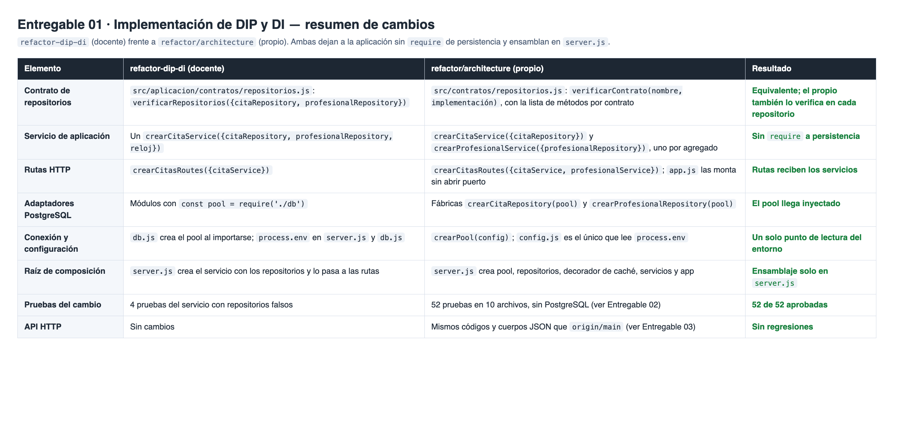

# Entregable 01 · Implementación de DIP y DI

Resumen de los cambios de `refactor/architecture` frente a `refactor-dip-di` (versión del docente).

| Archivo | Qué muestra |
|---|---|
| `01-resumen-de-cambios.png` | Cuadro comparativo de contrato, servicios, rutas, adaptadores, configuración y raíz de composición, con el resultado de cada punto |

