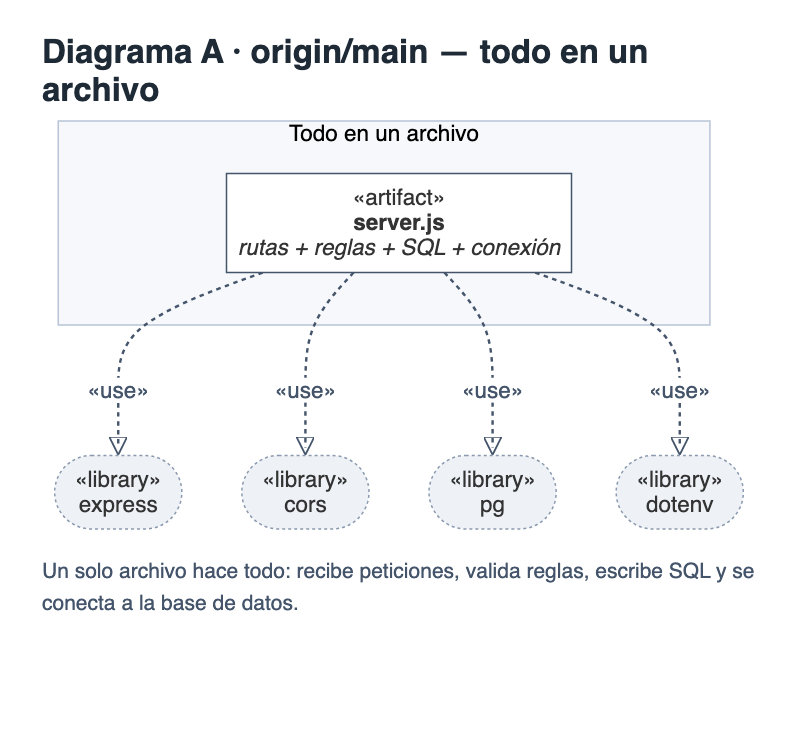
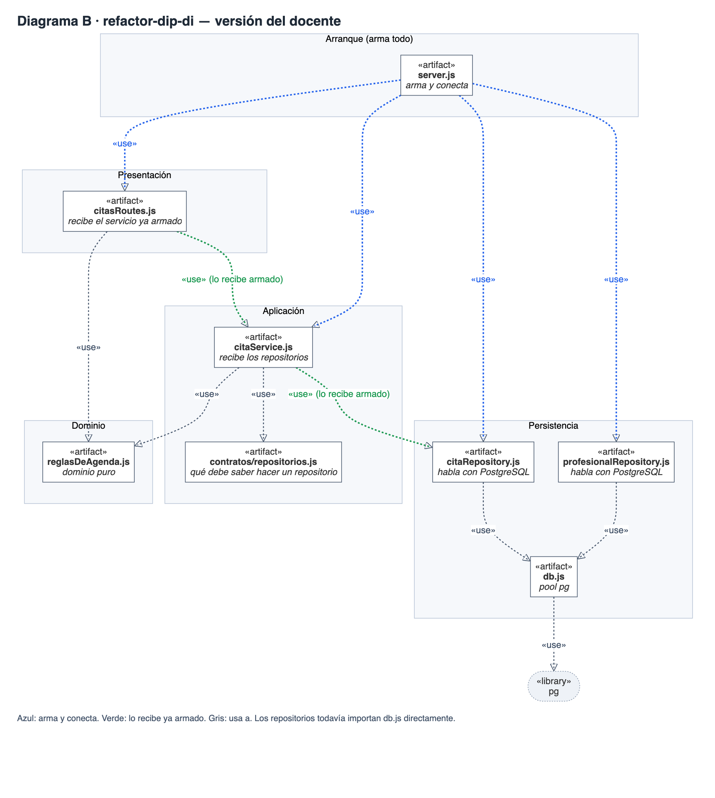
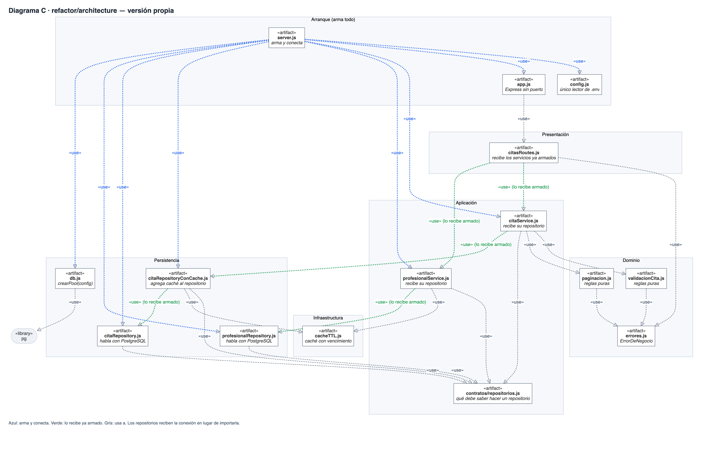
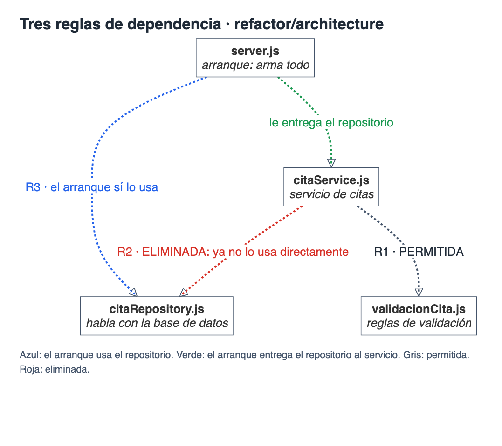

# Entregable 04 · Diagramas de dependencias

Los diagramas muestran **qué archivo usa a cuál** en cada versión del proyecto. Así se ve cuánto está "pegado" cada archivo a los demás.

**Cómo leerlos**

| Línea | Significa |
|---|---|
| Gris punteada | "usa a" ese archivo |
| Azul punteada | "arma y conecta" ese archivo al arrancar |
| Verde punteada | "lo recibe ya armado", sin importarlo |
| Roja punteada | dependencia que se quitó |

## Los tres diagramas

| Rama | Diagrama | Archivos | Idea en una frase |
|---|---|---|---|
| `origin/main` | A | 1 | Un solo archivo hace todo |
| `refactor-dip-di` (docente) | B | 8 | El servicio ya no importa los repositorios: los recibe armados |
| `refactor/architecture` (propio) | C | 15 | Lo mismo, llevado a todas las capas, más pruebas y caché |

### A · `origin/main`: todo en un archivo
`server.js` recibe las peticiones, valida las reglas, escribe el SQL y se conecta a la base de datos. Nada está separado.

### B · `refactor-dip-di`: el servicio recibe sus repositorios
El servicio de citas ya no importa los archivos que hablan con la base de datos; los recibe desde `server.js`. Los repositorios, en cambio, todavía importan `db.js` directamente.

### C · `refactor/architecture`: la misma idea en todas las capas
Los repositorios reciben la conexión en lugar de importarla, la configuración vive en un solo archivo y `server.js` arma todo.

### Qué cambió entre B y C

| | B (docente) | C (propio) |
|---|---|---|
| Servicio de citas | Recibe los repositorios | Recibe el repositorio |
| Repositorios | Importan `db.js` | Reciben la conexión |
| Configuración | Se lee en dos archivos | Se lee en un solo archivo |
| Servicios | Uno para citas y profesionales | Uno por cada tema |

## Tres reglas explicadas

| Regla | Qué dice | Por qué está bien |
|---|---|---|
| **R1 · Permitida** | El servicio de citas usa las reglas de validación (datos completos, fecha futura, horario libre) | Las reglas son código simple que no depende de la web ni de la base de datos; apoyarse en ellas es seguro |
| **R2 · Eliminada** | El servicio de citas ya no usa directamente el archivo que habla con la base de datos; solo pide "algo que sepa listar y guardar citas" | Se puede probar con datos falsos y cambiar de base de datos sin tocar el servicio |
| **R3 · Del arranque a la infraestructura** | `server.js` sí usa los archivos de la base de datos y la conexión | Es el único lugar que arma las piezas al arrancar; el resto del código no se entera de cuál base se usa |

Los fuentes de los diagramas están en los archivos `.mmd` de esta carpeta.
