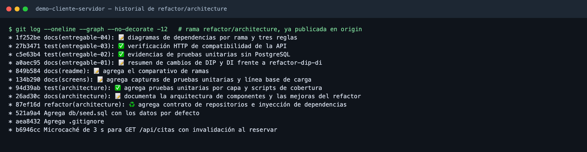

# Entregable 05 · Trazabilidad en GitHub, diferencias y límites pendientes

## 1. Dónde ver el trabajo

Rama [`refactor/architecture`](https://github.com/Null01/demo-cliente-servidor/tree/refactor/architecture) en GitHub, sin pull request ni merge a `main`.

## 2. Commits por entregable

| Entregable | Commit | Qué se puede revisar |
|---|---|---|
| 01 · DIP y DI | [`87ef16d`](https://github.com/Null01/demo-cliente-servidor/commit/87ef16d) | El código: contrato de repositorios, servicios, rutas y `server.js` |
| 01 · DIP y DI | [`a0aec95`](https://github.com/Null01/demo-cliente-servidor/commit/a0aec95) | Resumen de cambios frente a la rama del docente |
| 02 · Pruebas unitarias | [`94d39ab`](https://github.com/Null01/demo-cliente-servidor/commit/94d39ab) | Las 52 pruebas en `test/` y los scripts de `package.json` |
| 02 · Pruebas unitarias | [`c5e63b4`](https://github.com/Null01/demo-cliente-servidor/commit/c5e63b4) | Capturas de ejecución y cobertura |
| 03 · Compatibilidad HTTP | [`27b3471`](https://github.com/Null01/demo-cliente-servidor/commit/27b3471) | `test/api-smoke.js` y las capturas |
| 04 · Diagramas | [`1f252be`](https://github.com/Null01/demo-cliente-servidor/commit/1f252be) | Diagramas por rama y reglas explicadas |
| Apoyo | [`849b584`](https://github.com/Null01/demo-cliente-servidor/commit/849b584) | Cuadro comparativo de ramas en el README |
| Apoyo | [`26ad30c`](https://github.com/Null01/demo-cliente-servidor/commit/26ad30c) | Documentación de la arquitectura |

## 3. Límites y pendientes

- **Base de pruebas local.** Las verificaciones HTTP se hicieron con PostgreSQL en el computador. No se probó contra Supabase ni se redesplegó en Render; la actividad no lo exige.
- **Peticiones simultáneas.** La reserva usa una sola consulta pensada para evitar duplicados, pero el 409 solo se comprobó con peticiones una tras otra.
- **Cobertura.** El 100 % cuenta solo los archivos que cargan las pruebas. `server.js`, `config.js` y `db.js` no tienen pruebas.
- **El contrato revisa poco.** Solo comprueba que existan los métodos; no verifica que hagan lo correcto.
- **Dependencia pendiente.** `profesionalService.js` importa `cacheTTL.js`, una utilidad concreta, desde la capa de aplicación.
- **Lista paginada y página web.** La página no pide más páginas: con más de 50 citas solo vería las primeras 50.
- **Caché en memoria.** Vive en el servidor; si hubiera varias instancias, cada una tendría la suya.
- **Node 22.5 o más.** Hay que confirmar la versión que usa Render antes de desplegar.
